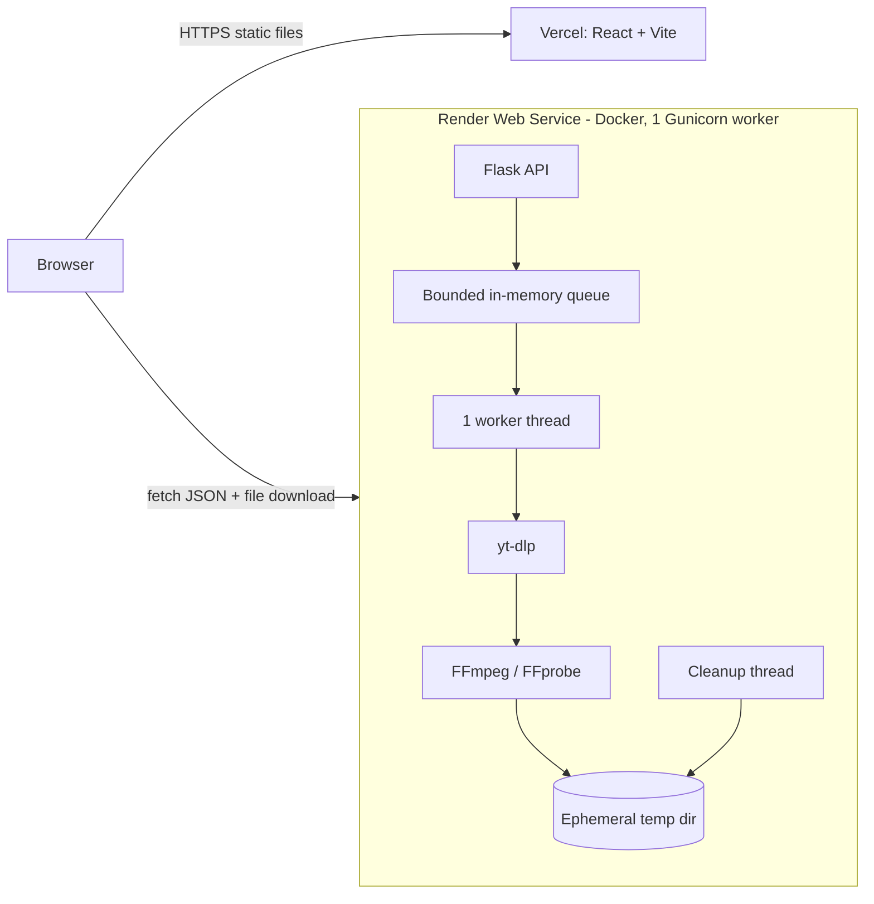

# StreamDrop

Download a public video from **YouTube, TikTok or Instagram** as **MP4**, or extract its audio as **MP3**, from your browser.
React + Vite frontend (Vercel), Flask + yt-dlp + FFmpeg backend (Render).

> **Responsible use.** Only download content you own or have permission to use. You are responsible for
> following copyright law and each platform's terms of service. Downloading from YouTube, TikTok or Instagram
> may violate their terms for content you do not have rights to. Do not remove a creator's attribution or
> present someone else's work as your own. Deploy and operate this project at your own risk.

---

## 1. Project overview

StreamDrop has two independently deployable parts:

| Part | Folder | Hosting | Job |
|------|--------|---------|-----|
| Frontend | `frontend/` | Vercel | UI, validation hints, polling, triggers the browser download |
| Backend | `backend/` | Render (Docker) | URL validation, yt-dlp metadata, queued media processing, file delivery |

Nothing is mocked: metadata comes from yt-dlp, progress comes from yt-dlp hooks, and files are served by the
backend with a `Content-Disposition: attachment` header so the **browser** saves them using its normal download
behaviour (a website cannot silently write into your Downloads folder).

## 2. Features

- Three platforms with automatic detection from the pasted link: YouTube, TikTok, Instagram (public content only)
- Real metadata: title, thumbnail, duration, channel, and the qualities the video actually offers
- Honest, optional "Download without watermark (when available)" for TikTok; never faked (see section 2a)
- MP4 (360p / 480p / 720p / 1080p / best) and MP3 (128 / 192 / 256 / 320 kbps)
- Exact-resolution selection: a lower resolution is never silently substituted
- Bounded queue (1 active job, 5 waiting by default), queue position, queue-full `503` with `Retry-After`
- Honest progress: real percentages while downloading, indeterminate bar for merging / MP3 conversion
- Rate limiting, duplicate-job protection, per-client job cap
- SSRF-safe URL allowlist, safe filenames, unguessable job IDs, automatic file expiry and cleanup
- Restrictive CORS (explicit origins), security headers, structured JSON logs

## 2a. Supported platforms, detection and limitations

| Platform | Accepted links | Not supported |
|----------|----------------|---------------|
| YouTube | `watch?v=`, `youtu.be/…`, `/shorts/…`, `/embed/…`, `/live/…` (on youtube.com, m., music., youtu.be) | Playlists, channels, live streams, premieres, members-only, age-restricted |
| TikTok | `tiktok.com/@user/video/<id>`, `m.tiktok.com/…`, short links `vm.tiktok.com/…`, `vt.tiktok.com/…`, `tiktok.com/t/…` | Profiles, photo/slideshow posts, private videos |
| Instagram | `instagram.com/reel/…`, `/reels/…`, `/p/…`, `/tv/…`, `/<user>/reel/…` | Stories, profiles, `share/` links, carousels, image-only posts, anything that requires a login |

**How platform detection works.** The server looks only at the link's hostname against exact-match allowlists
(no wildcards, no IP addresses), then validates the path for that platform, extracts the media ID, and
**rebuilds a canonical URL**. Only that rebuilt URL is ever given to yt-dlp, so tracking parameters, odd ports,
credentials and look-alike hosts never reach it. The browser mirrors this to show an icon and friendly hints, but
the server decides. TikTok short links are resolved by the server one redirect at a time; every hop must be
HTTPS on a TikTok host, otherwise the link is refused.

**What "works" means.** StreamDrop uses yt-dlp's own extractors and only for public content they can retrieve
without a login. It does not bypass logins, private accounts, DRM or anti-abuse systems, and it never asks for
passwords or session cookies. TikTok and Instagram change often, and Instagram in particular frequently demands a
login even for public-looking posts. **Expect failures; no platform or URL is guaranteed.** Failures are reported
as clear errors (`login_required`, `video_private`, `video_unavailable`, `no_video`, `source_blocked`,
`extractor_failed`, …). Platforms can be switched off with `ENABLED_PLATFORMS`.

**Quality options.** YouTube offers the fixed ladder (360p/480p/720p/1080p) where the video has it. TikTok and
Instagram list only the heights their files really have; if there is just one, the UI shows "Original quality"
and no YouTube-style choices.

**Watermark-free option (TikTok/Instagram video downloads only).**
- TikTok: yt-dlp labels some files as watermarked (in each file's `format_note`). StreamDrop reports the option as
  *available* only when the source offers at least one video file that is **not** labelled that way, and then
  downloads only from those files. If the source offers none, the checkbox is disabled with the reason, and a
  direct request is refused with `422 watermark_free_unavailable`. Nothing is silently swapped; you can then
  choose the original version yourself (the UI offers a button). This depends on TikTok's labelling, so it is a
  signal, not a guarantee. Always check the result.
- Instagram: Instagram does not provide a separate watermark-free file, so the capability is reported as
  unavailable. Creator-added overlays cannot be removed.
- Watermarks are never stripped or edited out of video, and unverified third-party download APIs are not used.

## 3. Architecture



Request flow: `POST /api/metadata` → choose format → `POST /api/downloads` (job queued, `202`) →
poll `GET /api/downloads/<id>` every 1.5 s → when `completed`, the browser opens
`GET /api/downloads/<id>/file` and saves the file.

## 4. Technology stack

React 18, Vite 5, JavaScript, CSS3, Lucide React · Python 3.11, Flask 3, Flask-CORS, yt-dlp, FFmpeg/FFprobe,
Gunicorn · Docker (Render), Vercel, Git/GitHub.

## 5. Project structure

```
StreamDrop/
├── frontend/
│   ├── public/favicon.svg
│   ├── src/
│   │   ├── components/   Navbar, Hero, DownloadForm, VideoPreview, QualitySelector, FormatSelector,
│   │   │                 DownloadProgress, QueueStatus, ErrorMessage, Features, HowItWorks, Faq, Footer,
│   │   │                 PlatformIcon, WatermarkOption
│   │   ├── hooks/        useDownloadFlow.js (state machine + polling), useBackendStatus.js (health check)
│   │   ├── services/api.js     <- the ONLY file that calls the backend
│   │   ├── utils/platform.js   Platform detection + friendly URL hints (server re-validates)
│   │   ├── styles/global.css
│   │   ├── App.jsx, main.jsx
│   ├── .env.example, .gitignore, index.html, package.json, vite.config.js, vercel.json
├── backend/
│   ├── app.py              Flask app factory, routes, CORS, errors, security headers
│   ├── config.py           Environment-driven settings
│   ├── downloader.py       yt-dlp metadata + download + error translation
│   ├── queue_manager.py    JobQueue interface + InMemoryJobQueue
│   ├── validators.py       URL allowlist, format/quality validation, safe filenames
│   ├── cleanup.py          Temp-dir removal, orphan purge, sweeper thread
│   ├── rate_limit.py       Sliding-window limiter
│   ├── tests/              pytest suite (network and yt-dlp extraction are mocked; test_platforms.py covers TikTok/Instagram)
│   ├── requirements.txt, requirements-dev.txt, Dockerfile, render.yaml, .env.example, .gitignore
├── README.md
└── .gitignore
```

## 6. Prerequisites

| Tool | Version |
|------|---------|
| Python | 3.11 (3.10–3.12 work) |
| Node.js | 18.18+ (20 LTS recommended) |
| Git | any recent |
| FFmpeg + FFprobe | any recent build, on `PATH` |

## 7. Installing the tools (Windows PowerShell)

```powershell
winget install --id Python.Python.3.11 -e
winget install --id OpenJS.NodeJS.LTS -e
winget install --id Git.Git -e
winget install --id Gyan.FFmpeg -e
```

Close and reopen PowerShell afterwards so `PATH` updates. (Manual installers: python.org, nodejs.org,
git-scm.com, and an FFmpeg build such as gyan.dev; add the FFmpeg `bin` folder to `PATH`.)

## 8. Verify FFmpeg and FFprobe

```powershell
py --version
node --version
git --version
ffmpeg -version
ffprobe -version
```

All five must print a version. Without FFmpeg the backend still starts, but `/api/capabilities` reports
`"ffmpeg": false` and downloads are refused with `ffmpeg_missing`.

## 9. Backend virtual environment

```powershell
cd backend
py -m venv .venv
.\.venv\Scripts\Activate.ps1
python -m pip install --upgrade pip
```

**If activation fails** with "running scripts is disabled on this system", allow scripts for this PowerShell
window only (no system-wide change):

```powershell
Set-ExecutionPolicy -Scope Process -ExecutionPolicy Bypass
.\.venv\Scripts\Activate.ps1
```

Alternative that avoids the policy entirely: `.\.venv\Scripts\python.exe app.py` (or use `cmd` and `.venv\Scripts\activate.bat`).

## 10. Install backend requirements

```powershell
pip install -r requirements-dev.txt   # includes pytest; use requirements.txt for runtime only
```

## 11. Install frontend dependencies

```powershell
cd ..\frontend
npm install
```

## 12. Create the environment files

```powershell
cd ..\backend
Copy-Item .env.example .env
cd ..\frontend
Copy-Item .env.example .env
```

| File | Location | Key values for local development |
|------|----------|----------------------------------|
| Backend env | `backend\.env` | `APP_ENV=development`, `ALLOWED_ORIGINS=http://localhost:5173,http://127.0.0.1:5173` |
| Frontend env | `frontend\.env` | `VITE_API_BASE_URL=http://127.0.0.1:5000` |

`.env` files are git-ignored. The backend reads `backend\.env` automatically; real environment variables
override it. **Never put secrets in `VITE_*` variables**: Vite embeds them in public JavaScript.

## 13. Run the backend locally

Terminal 1:

```powershell
cd backend
.\.venv\Scripts\Activate.ps1
python app.py
```

It listens on `http://127.0.0.1:5000`. (Gunicorn does not run on Windows; `python app.py` is the local
development server. Production uses Gunicorn inside Docker.)

## 14. Run the frontend locally

Terminal 2 (start the backend first):

```powershell
cd frontend
npm run dev
```

Open `http://localhost:5173`.

## 15. CORS for local development

With `APP_ENV=development`, the backend defaults to allowing `http://localhost:5173` and
`http://127.0.0.1:5173`. The origin in your address bar must match an entry **exactly** (`localhost` and
`127.0.0.1` are different origins). Production never allows `*`; a `*` entry in `ALLOWED_ORIGINS` is ignored.

## 16. Connecting the frontend to the local API

`frontend/src/services/api.js` reads `VITE_API_BASE_URL` (origin only, no trailing slash, no `/api`) and
composes `${API_BASE}/api/...`. Restart `npm run dev` after editing `.env`. The footer status dot turns green
only when `GET /api/health` actually succeeds.

## 17. Testing every API endpoint

```powershell
$B = "http://127.0.0.1:5000"
Invoke-RestMethod "$B/api/health"
Invoke-RestMethod "$B/api/capabilities"

$meta = @{ url = "https://www.youtube.com/watch?v=VIDEO_ID" } | ConvertTo-Json
Invoke-RestMethod "$B/api/metadata" -Method Post -ContentType "application/json" -Body $meta

$body = @{ url = "https://www.youtube.com/watch?v=VIDEO_ID"; format = "mp4"; quality = "720p" } | ConvertTo-Json
$job = Invoke-RestMethod "$B/api/downloads" -Method Post -ContentType "application/json" -Body $body
$id = $job.job.id
Invoke-RestMethod "$B/api/downloads/$id"
Invoke-WebRequest "$B/api/downloads/$id/file" -OutFile "test-download.mp4"   # once status is "completed"
Invoke-RestMethod "$B/api/downloads/$id" -Method Delete                      # cancel waiting job / delete finished job
```

| Endpoint | Purpose | Notable responses |
|----------|---------|-------------------|
| `GET /api/health` | Liveness + version (no media work) | `200` |
| `GET /api/capabilities` | Formats, qualities, queue capacity, FFmpeg presence, limits | `200` |
| `POST /api/metadata` `{url}` | Verified metadata + supported resolutions | `400` invalid URL, `422/404` video problems, `429`, `503` |
| `POST /api/downloads` `{url, format, quality?, audio_bitrate?}` | Create a job | `202` created, `200` duplicate, `422` unavailable quality, `429`, `503` queue full (+`Retry-After`) |
| `GET /api/downloads/<id>` | Status: `queued`, `processing`, `completed`, `failed`, `expired` (+ progress when real) | `404` unknown |
| `GET /api/downloads/<id>/file` | Attachment download | `409` not ready, `410` expired, `404` |
| `DELETE /api/downloads/<id>` | Cancel waiting job / remove finished job | `409` while processing |

All errors share one shape: `{"ok": false, "error": {"code": "...", "message": "..."}}`. Tracebacks and file
paths are logged server-side only.

### 17a. Updated request examples (multi-platform)

The endpoints are unchanged. `watermark_free` is an optional boolean (default `false`); it is rejected for
YouTube, for MP3, and for non-boolean values (`400 invalid_watermark_free`).

```powershell
$B = "http://127.0.0.1:5000"

# TikTok, original version (may include TikTok's watermark)
$body = @{ url = "https://www.tiktok.com/@USER/video/1234567890123456789"; format = "mp4"; quality = "best"; watermark_free = $false } | ConvertTo-Json
Invoke-RestMethod "$B/api/downloads" -Method Post -ContentType "application/json" -Body $body

# TikTok, watermark-free (only accepted if metadata says it is available)
$body = @{ url = "https://www.tiktok.com/@USER/video/1234567890123456789"; format = "mp4"; quality = "best"; watermark_free = $true } | ConvertTo-Json

# Instagram Reel
$body = @{ url = "https://www.instagram.com/reel/SHORTCODE/"; format = "mp4"; quality = "best" } | ConvertTo-Json

# TikTok short link (resolved server-side)
$meta = @{ url = "https://vm.tiktok.com/CODE/" } | ConvertTo-Json
Invoke-RestMethod "$B/api/metadata" -Method Post -ContentType "application/json" -Body $meta
```

New fields in the `/api/metadata` response: `platform`, `platform_label`, `quality_mode`
(`selectable` or `original`), `notes`, and
`watermark_free: { applies, available, qualities, reason }`. `/api/capabilities` gains `platforms`:
`id`, `label`, `enabled`, `content_types`, `quality_options`, and `watermark_free`
(`not_applicable`, `per_video`, or `unavailable`). New error codes: `unsupported_content`, `platform_disabled`,
`watermark_free_unavailable`, `invalid_watermark_free`, `login_required`, `video_private`, `no_video`,
`extractor_failed`, `short_link_unresolvable`. A job's status now includes `platform`, `watermark_free` and an
`output_note` describing honestly what kind of file it is.

## 18. Testing MP4 and MP3 downloads

Use only media you are authorised to download (for example your own upload or Creative Commons content).
See the manual checklist in section 26. Automated tests mock yt-dlp, so they do **not** prove YouTube
extraction works; the manual test does.

Run the automated suite:

```powershell
cd backend
.\.venv\Scripts\Activate.ps1
python -m pytest -q
```

### 18a. Testing each platform locally

Use only public videos you are allowed to download (your own uploads, or content whose owner permits it).

1. Start the backend and frontend (sections 13 and 14).
2. **YouTube:** paste a `watch?v=` link → Fetch Details → pick MP4 or MP3 → Download.
3. **TikTok:** paste a `tiktok.com/@user/video/<id>` link, and also a `vm.tiktok.com/…` short link. Check that
   the checkbox is enabled or disabled with a reason; try downloading with and without it.
4. **Instagram:** paste a public `instagram.com/reel/…` link. Expect that many links fail with a login/availability
   error. That is normal; the app should explain it rather than crash.
5. **Rejections:** try a profile link, an Instagram Story, a `vimeo.com` link and `http://127.0.0.1/`. All should
   be refused with a clear message.

Automated checks (no network needed): `python -m pytest -q` in `backend/`.

## 19. GitHub repository setup

Create an empty repository on github.com (no README), then from the project root:

```powershell
cd StreamDrop
git init
git add .
git status          # confirm no .env, node_modules, .venv or media files are listed
git commit -m "Initial commit: StreamDrop"
git branch -M main
git remote add origin https://github.com/YOUR-USER/StreamDrop.git
git push -u origin main
```

## 20. Deploy the backend on Render

1. Push the project to GitHub (section 19).
2. Render dashboard → **New → Web Service** → connect the GitHub repository.
3. **Language/Runtime:** Docker. **Root Directory:** `backend` (this makes `backend/` the Docker build context
   and finds `backend/Dockerfile`). **Instance type:** Free.
4. **Health Check Path:** `/api/health`.
5. Add the environment variables from section 22.
6. **Create Web Service** and wait for the build to finish.
7. Open `https://YOUR-BACKEND.onrender.com/api/health`. Expect `{"ok":true,"status":"ok","version":"1.0.0"}`.
   The first request after sleeping can take about a minute.
8. Copy the real URL shown at the top of the service page. Do not guess it.

`backend/render.yaml` is an optional Blueprint equivalent using repo-root-relative paths. Render normally
reads Blueprints from the repository root; if you want to use it, check Render's current docs for custom
Blueprint file paths or copy it to the repo root. The manual steps above are the verified-simple route.

## 21. FFmpeg on Render

`backend/Dockerfile` installs FFmpeg (which includes FFprobe) with `apt-get`, copies Deno (the JavaScript
runtime yt-dlp uses for current YouTube extraction), installs Python packages, runs as a non-root user and
starts Gunicorn with **one worker and eight threads**. After deploy, `GET /api/capabilities` must show
`"ffmpeg": true`.

## 22. Backend environment variables

| Variable | Production value | Notes |
|----------|------------------|-------|
| `APP_ENV` | `production` | **Set.** |
| `ALLOWED_ORIGINS` | `https://YOUR-FRONTEND.vercel.app` | **Required.** Exact origin(s), comma-separated, no trailing slash |
| `ALLOWED_ORIGIN_REGEX` | optional | Whole-origin regex for Vercel previews, e.g. `https://streamdrop-[a-z0-9-]+-your-team\.vercel\.app` |
| `TRUST_PROXY_HOPS` | `1` | **Set on Render** so rate limits see real client IPs |
| `MAX_ACTIVE_JOBS` | `1` | Keep at 1 on Free |
| `MAX_WAITING_JOBS` | `5` | Queue size |
| `MAX_JOBS_PER_CLIENT` | `2` | Active + waiting per IP |
| `RATE_LIMIT_METADATA` / `_DOWNLOADS` / `_STATUS` | `20/60`, `5/60`, `240/60` | requests/seconds per IP |
| `JOB_TTL_SECONDS` | `900` | Finished file lifetime |
| `DELIVERED_GRACE_SECONDS` | `300` | Time left after a full delivery |
| `TEMP_DIR` | `/tmp/streamdrop` (Docker default) | Ephemeral |
| `MAX_DURATION_SECONDS` | `3600` | Longer videos are refused |
| `MAX_FILESIZE_MB` | `300` | Output size cap |
| `DEFAULT_AUDIO_BITRATE` | `192` | 128/192/256/320 |
| `LOG_LEVEL` | `INFO` | |
| `ENABLED_PLATFORMS` | `youtube,tiktok,instagram` | Comma-separated. Remove a platform to turn it off (e.g. if its extractor is broken) |
| `LINK_RESOLVE_TIMEOUT_SECONDS` | `8` | Timeout for resolving TikTok short links |
| `YTDLP_COOKIES_FILE` | empty | **YouTube only**; never sent to TikTok or Instagram. See troubleshooting before using |

No new Python or npm dependencies were added for multi-platform support (short-link resolution uses the standard
library). Render and Vercel settings are unchanged; just redeploy both after pulling these changes.

Render supplies `PORT` automatically; the Dockerfile binds to it.

## 23. Deploy the frontend on Vercel

1. Vercel → **Add New → Project** → import the GitHub repository.
2. **Root Directory:** `frontend`. **Framework Preset:** Vite.
3. **Build Command:** `npm run build`. **Output Directory:** `dist`. (`frontend/vercel.json` also states these.)
4. Add `VITE_API_BASE_URL` (next section) and **Deploy**.

## 24. Set `VITE_API_BASE_URL` in Vercel

Project → Settings → Environment Variables → add (Production, and Preview if you use previews):

```
VITE_API_BASE_URL = https://YOUR-BACKEND.onrender.com
```

Origin only: **no trailing slash and no `/api`** (the app strips both defensively). Vite replaces this value at
**build time**, so after adding or changing it you must **redeploy** (Deployments → ⋯ → Redeploy). It is public
configuration, not a secret.

## 25. Connect Vercel to Render

1. Deploy the backend; copy `https://YOUR-BACKEND.onrender.com`.
2. Set it as `VITE_API_BASE_URL` in Vercel; deploy the frontend; copy `https://YOUR-FRONTEND.vercel.app`.
3. In Render → Environment, set `ALLOWED_ORIGINS=https://YOUR-FRONTEND.vercel.app` (and optionally
   `ALLOWED_ORIGIN_REGEX` for previews). Render restarts the service.
4. Reload the live site; the footer should show **Server online**.

## 26. Verify the live deployment

- `https://YOUR-BACKEND.onrender.com/api/health` returns `ok`
- `https://YOUR-BACKEND.onrender.com/api/capabilities` shows `"ffmpeg": true`
- The live site footer shows **Server online** with the backend version
- Fetch details for an authorised test video, then download one MP4 and one MP3

**Manual end-to-end checklist (authorised media only)**

- [ ] Metadata shows the correct title, thumbnail, duration and uploader
- [ ] Only resolutions the video offers appear; `best` is present
- [ ] MP4 at a listed quality downloads, plays, and has the expected height (`ffprobe file.mp4`)
- [ ] MP3 downloads and plays; bitrate roughly matches the choice
- [ ] Progress moves during download; merge/convert phases show an indeterminate bar
- [ ] Two quick submissions: the second queues with a position; a sixth waiting job gets "queue full"
- [ ] Cancelling a waiting job works; cancelling a running job is refused
- [ ] `http://127.0.0.1/` and a non-YouTube URL are rejected
- [ ] After the TTL, the file link returns `410` and the temp directory is empty
- [ ] Browser console shows no CORS errors

## 27. Troubleshooting

| Symptom | Likely cause and fix |
|---------|----------------------|
| Vercel page loads but metadata fails | Open DevTools → Network. Wrong `VITE_API_BASE_URL`, CORS, or sleeping backend. Check the failing request URL first |
| Wrong Render URL / `/api/api/...` | `VITE_API_BASE_URL` must be the bare origin. Fix and **redeploy** Vercel |
| CORS error in console | `ALLOWED_ORIGINS` must exactly equal the page origin (scheme + host, no trailing slash). Preview URLs need `ALLOWED_ORIGIN_REGEX` |
| First request very slow / timeout | Render Free sleeps after idle; the first request wakes it (~1 min). Retry once |
| Health check failing on Render | Check logs; confirm health path `/api/health`; confirm the container binds `$PORT` |
| `ffmpeg_missing` | You are not running the Docker image (or FFmpeg is not on `PATH` locally). Re-run section 8 |
| `extraction_failed` / `source_blocked` | YouTube changed or blocks datacenter IPs. Redeploy to pick up the newest yt-dlp (`pip install -U yt-dlp`). Cloud hosts such as Render are often challenged with "confirm you're not a bot". `YTDLP_COOKIES_FILE` can help, but cookies are tied to a Google account that may be restricted for automated use; use a throwaway account and treat the file as a secret. There is no guaranteed fix on free hosting |
| `quality_unavailable` | That exact resolution does not exist for the video. Pick a listed one or `best`. Vertical/unusual-size videos may list no standard heights; use `best` |
| MP3 conversion failed | FFmpeg missing, out of memory, or file too large. Check logs and `MAX_FILESIZE_MB` |
| HTTP 429 | Rate limit; wait `Retry-After` seconds |
| HTTP 503 `queue_full` | Queue is full; retry later (frontend offers Try again) |
| "Job not found" mid-download | The service restarted or slept; in-memory jobs are lost. Start again |
| Files vanish | By design: expiry and cleanup, plus ephemeral disk |
| Vercel build error | Root Directory must be `frontend`; Node 18.18+; run `npm run build` locally to reproduce |
| Env var change has no effect | Vercel: redeploy. Render: the service restarts automatically after saving. Local Vite: restart `npm run dev` |
| TikTok/Instagram suddenly fail with `extractor_failed` / `extraction_failed` | The platform changed. Redeploy the backend with **Clear build cache & deploy** so Docker installs the newest yt-dlp, or `pip install -U yt-dlp` locally. Switch the platform off with `ENABLED_PLATFORMS` meanwhile |
| `login_required` / `video_private` | The post is private or the platform demands a login. StreamDrop will not bypass this. Use a public post |
| `unsupported_url` / `unsupported_content` | The link is a profile, Story, photo post, share link, playlist or carousel. Copy the link to one specific video |
| `short_link_unresolvable` | The `vm.tiktok.com` link expired or TikTok could not be reached. Open it in a browser and paste the full `tiktok.com/@user/video/…` link |
| Watermark-free checkbox is disabled | The source offers no file it labels as watermark-free (always true for Instagram). Use the original version if you have permission |
| `source_blocked` on TikTok/Instagram | The platform blocks the server's IP (common on cloud hosts). Run the backend from a home connection or try later |
| Tests fail on import | Activate the venv and run `pytest` from `backend/` |

## 28. Free-tier resource limits

Render Free is for experiments: roughly 512 MB RAM and a fraction of a CPU, the service **sleeps when idle**,
the filesystem is **not durable**, and it restarts or redeploys without notice. 50–200 simultaneous visitors
can browse the static site (served by Vercel), but the backend can only process about **one** conversion at a
time. Visitors beyond the queue see a polite "queue full" message. Verify current limits on Render's pricing page.
Paid instances give more CPU/RAM, no sleeping and persistent disks, which is the first step towards real capacity.

## 29. Queue behaviour and concurrency

- `MAX_ACTIVE_JOBS=1` worker thread processes jobs; `MAX_WAITING_JOBS=5` can wait; more get `503` + `Retry-After`
- One FFmpeg/yt-dlp job at a time; **never** one process per request
- HTTP requests return immediately (`202`); the browser polls status
- Submitting the same media/format/quality again while it is active returns the existing job
- Per-IP caps (`MAX_JOBS_PER_CLIENT`) and rate limits bound abuse
- The queue is **in memory**: jobs are lost on restart or sleep, and it is **not shared** across instances or
  multiple Gunicorn workers. That is why the container runs exactly one worker. Do not scale this beta out
  horizontally; it is not a durable production queue.
- `JobQueue` in `queue_manager.py` is the interface the API depends on, so a Redis-backed queue can replace it.

## 30. Security and responsible use

- Only these hosts are accepted: youtube.com, www./m./music.youtube.com, youtu.be. The URL is parsed, the
  video ID extracted, and yt-dlp receives a **canonical URL the server rebuilt**, so IPs, localhost, private
  ranges, credentials, odd ports and redirects-by-lookalike never reach yt-dlp
- TikTok short links are followed manually, one hop at a time; every hop must be HTTPS on a TikTok host
- Operator cookies (if configured) are used for YouTube only; user passwords and cookies are never requested
- Log lines strip URL query strings; yt-dlp's own output is routed through the same redaction
- Thumbnails are passed to the browser only from known platform CDN hosts
- No user-supplied yt-dlp options, FFmpeg arguments or shell commands; no `shell=True` anywhere
- Per-job private directories (`mkdtemp`), unguessable 192-bit job IDs, strict ID format checks, filenames
  sanitised from metadata, files only served from the job's own path
- Duration, file-size, queue, per-IP and rate limits; expiry plus sweeper cleanup; startup purge of orphans
- Restrictive CORS, `nosniff`, `X-Frame-Options: DENY`, `no-store`, JSON-only API CSP
- Job IDs act as bearer links: anyone who has one can fetch that file until it expires
- Not implemented: authentication, payments, malware scanning, abuse reporting. Add them before any public launch

## 31. Future scaling architecture

Replace `InMemoryJobQueue` with a Redis-backed queue (RQ/Celery/Arq), run separate worker containers sharing
object storage (S3/R2) for output files and presigned download links, keep Flask stateless with several
instances behind the platform load balancer, add Redis-based rate limiting, and (optionally) use SSE instead of
polling. None of these are required by the free-tier setup.

## 32. License and contributing

Add a `LICENSE` file of your choice (for example MIT) before publishing; none is included. yt-dlp (Unlicense),
FFmpeg (LGPL/GPL depending on build) and other dependencies have their own licences. Contributions: open an
issue first, keep Python and React code separate, add tests for backend changes, and run `python -m pytest -q`
and `npm run build` before sending a pull request.
